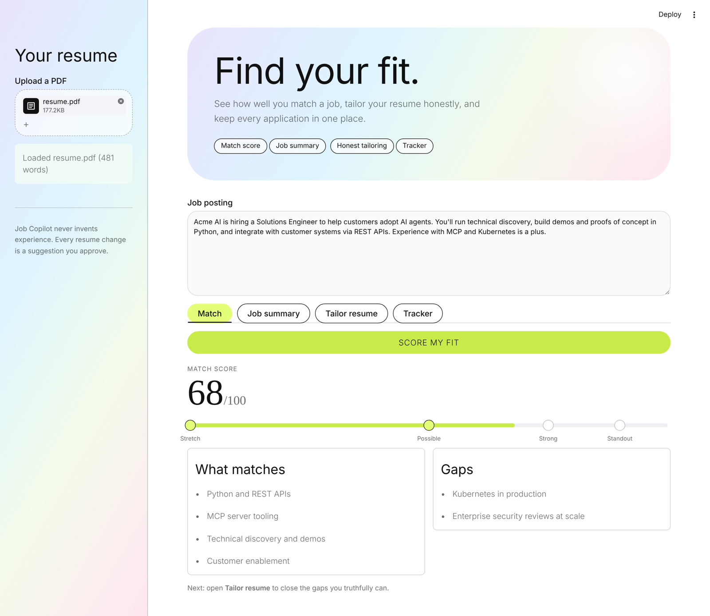
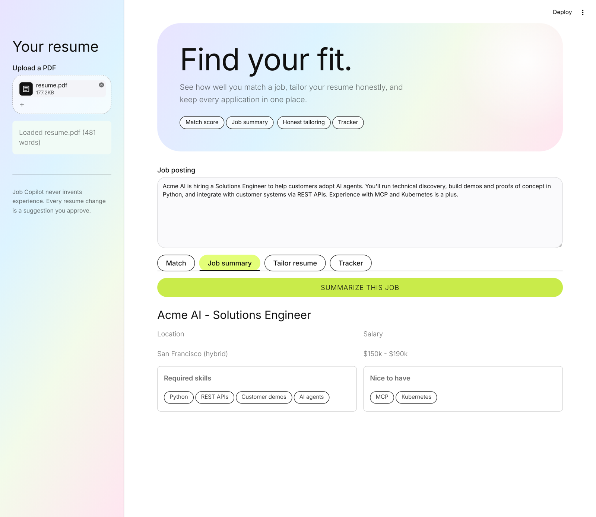
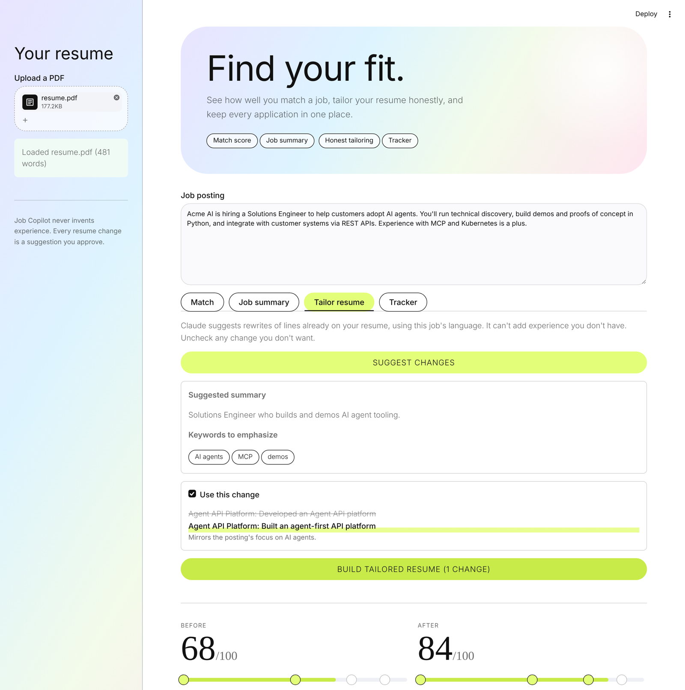
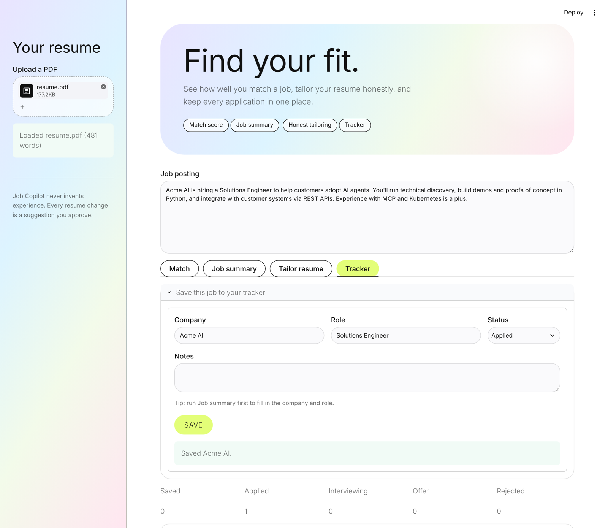

# Job Copilot

An AI job-search assistant built with Python, Streamlit and the Claude API. Upload your resume, paste a job posting, and Job Copilot shows how well you fit, what's missing, and how to tailor your resume for that job, without ever inventing experience.

**Live demo:** [job-copilot.streamlit.app](https://job-copilot-at8d5svsaw4fcejdfserzj.streamlit.app/) (password-protected to protect API credits. [Message me on LinkedIn](https://www.linkedin.com/in/hussan-asaf-36abbb428) for access)



<sub>Screenshots use a sample job posting for "Acme AI".</sub>

## Features

| Feature | What it does |
| --- | --- |
| **Match** | Scores your resume against a job from 0 to 100 and lists matching skills and gaps |
| **Job summary** | Pulls the company, role, location, salary, required skills and nice-to-haves out of a long posting |
| **Tailor resume** | Suggests rewrites of lines already on your resume, using the job's language. You approve each change, then see your score before and after |
| **Tracker** | Saves each application with its status (Saved → Applied → Interviewing → Offer / Rejected), notes, score and the tailored resume you used |

## Screenshots

| Job summary | Tailor resume |
| --- | --- |
|  |  |



## Honest by design

Many resume tools will happily make up skills. Job Copilot is built to avoid that:

- The tailoring prompt only allows rephrasing and re-emphasizing experience the resume already shows. It can't add employers, tools, numbers or results.
- Every change appears as a before/after that you accept or reject.
- The match score is re-run on the tailored resume, so improvements come from clearer wording, not invented claims.

## How it works

```
Resume PDF ──► pdfplumber (text) ─┐
                                  ├──► Claude API ──► JSON ──► Streamlit UI
Job posting (pasted) ─────────────┘                              │
                                                                 ▼
                                                         SQLite tracker
```

| File | Purpose |
| --- | --- |
| `app.py` | Streamlit interface with four tabs |
| `ui.py` | The visual style: pastel panels, outlined cards, lime buttons, tiered score track |
| `resume_reader.py` | Extracts text from a resume PDF |
| `job_matcher.py` | Scores fit and finds gaps |
| `job_summarizer.py` | Summarizes a job posting |
| `resume_tailor.py` | Suggests honest rewrites and applies the ones you accept |
| `tracker.py` | Stores applications in SQLite |

Each AI feature follows the same pattern: build a prompt, call Claude, find the text block in the response, parse the JSON, and return a Python dictionary.

## Run it locally

```bash
git clone https://github.com/ha1859/job-copilot.git
cd job-copilot
python3 -m venv .venv
source .venv/bin/activate
pip install -r requirements.txt
echo "ANTHROPIC_API_KEY=your-key-here" > .env
streamlit run app.py
```

Then open http://localhost:8501.

## Deploy (Streamlit Community Cloud)

1. Sign in at [share.streamlit.io](https://share.streamlit.io) with GitHub and create an app from this repo, using `app.py`.
2. Under **Advanced settings → Secrets**, add:
   ```toml
   ANTHROPIC_API_KEY = "your-key"
   APP_PASSWORD = "a-demo-password"
   ```
3. Deploy. `APP_PASSWORD` is optional. It keeps strangers from spending your API credits.

The tracker uses a local SQLite file, so on free hosting it resets when the app restarts.

## What I learned

- Designing prompts that return structured JSON, and handling responses that include more than one content block
- Giving the model context it doesn't have, like today's date, after it miscounted years of experience
- Keeping secrets out of code with `.env` and `.gitignore`
- Building guardrails so AI output stays truthful

## Roadmap

- Answers to application questions based on your resume and the company
- An MCP server so Claude can call Job Copilot's tools directly
